# SiliconScope

[English](README.md) · [Deutsch](README.de.md) · [简体中文](README.zh-CN.md) · **繁體中文** · [日本語](README.ja.md) · [한국어](README.ko.md)

[](https://siliconscope.calidalab.ai)
[](https://github.com/kennss/SiliconScope/releases/latest)
[](https://github.com/kennss/SiliconScope/releases)
[](LICENSE)


[](https://trendshift.io/repositories/57307)

**免 sudo 的 Apple Silicon 系統監控工具**。它同時是原生的 SwiftUI 儀表板**和**一整套選單列工具，並把活動監視器與終端機監控工具不會顯示的 **ANE（Neural Engine）**、**Media Engine** 與**記憶體頻寬**當成主要項目來追蹤。

當初只是想*親眼看看*裝置端 AI 與媒體工作負載怎麼使用 Apple Silicon 上的各個加速器，後來一路發展成可以取代 iStat Menus 的日常監控工具。

**4.0 新功能：連你的*其他*機器也一起看。** 不接螢幕的 Mac mini、桌子底下的 Linux GPU 主機、租來的雲端執行個體，只要在上面執行一個小小的 agent，它就會透過加密、經過配對的連線加入同一個儀表板。遠端的 Mac 一樣能看到完整資訊，**Neural Engine 也不例外**。

*曾獲 [OWC Rocket Yard](https://eshop.macsales.com/blog/99094-siliconscope-improves-upon-macos-activity-monitor-with-apple-silicon-insights/)（美國）、[AAPL Ch.](https://applech2.com/archives/20260620-siliconscope-apple-silicon-mac-system-monitor.html)（日本）、[ifun.de](https://www.ifun.de/siliconscope-ueberwacht-apple-ki-neural-engine-und-speicher-in-echtzeit-282222/)（德國）與 [MacMagazine](https://macmagazine.com.br/post/2026/09/02/monitore-todos-os-aspectos-do-seu-mac-com-o-aplicativo-siliconscope/)（巴西）報導。*

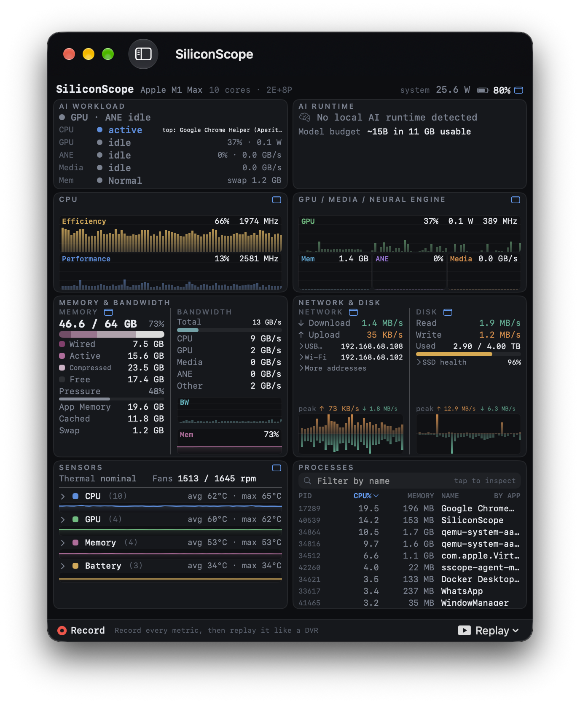

*一台執行 macOS 27 的 M1 Max，正承受真實的裝置端 AI 負載：[Spectalo](https://spectalo.calidalab.ai/) 正在執行它的 Core ML 模型。工作負載分類器判定為 **ANE (CoreML)**，Neural Engine **100 % 活躍，資料流量 16 GB/s**。這是實測的叢集駐留率（cluster residency），所以即使在 macOS 27 上也能即時更新；在這個版本上，這顆晶片的能耗計數器大約每半小時才更新一次。GPU 為 100 %、36 W，記憶體頻寬 306 GB/s，晶片上限是 400 GB/s（**頻寬受限**）；頂端的 **system 105 W** 是整台 Mac 的耗電量。只有需要注意的地方才會上色，這裡是超過 90 °C 的 CPU 與 GPU 溫度標成紅色，其餘一律維持中性色。底部那一條就是 **Replay**（3.0 新增）：所有指標都會記錄下來，可以像 DVR 一樣拖曳時間軸，回頭檢視整段過程。*

### 選單列：每項指標都能獨立顯示，iStat 風格

任何一張卡片都能釘選成獨立的選單列項目（**CPU · GPU · 記憶體 · 網路 · SSD · 感測器 · 電池**），各自有即時更新的圖示和內容豐富的下拉選單。每個項目都能自行選擇**顯示樣式**（長條 · 歷史圖表 · 雙行 · 單一數值 · 圖示）以及要畫出哪些讀數，所以同一項指標甚至可以出現兩次，例如 CPU 同時以長條*和*圖表顯示。全部不需要 sudo。

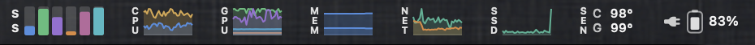

<p align="center">
  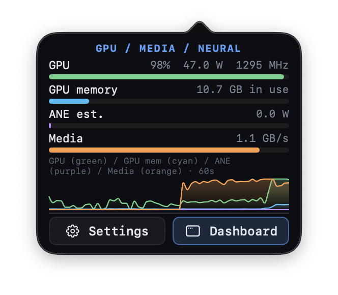
  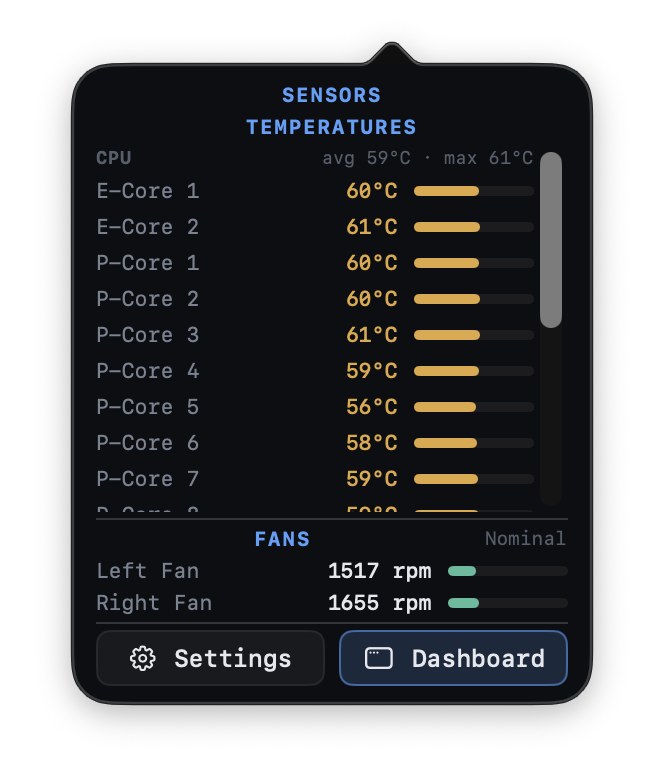
  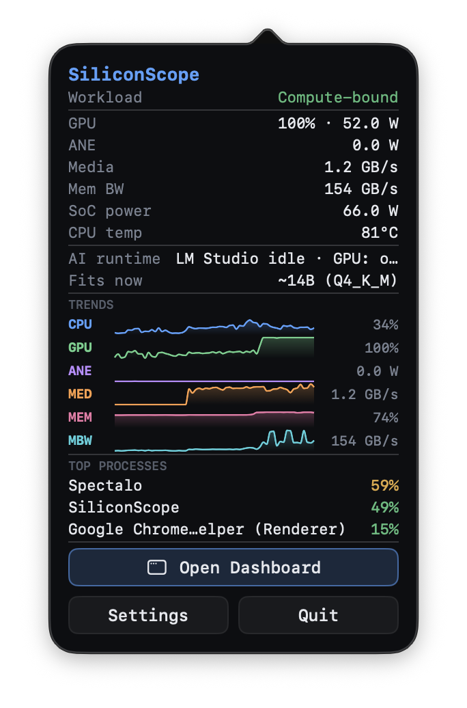
</p>

*資訊最豐富的幾個下拉選單。**GPU / Media / Neural**：以即時儀表顯示 GPU、GPU 記憶體、ANE 與 Media，並附 4 條曲線的 60 秒趨勢圖。**感測器**：各單元溫度讀自真正的 **E-Core / P-Core / GPU / Memory** 感測器（M1–M5 依晶片世代挑選 SMC key，其他機型改用 HID）。**SS 駕駛艙**：一個下拉選單看完整台機器，包括工作負載判定、每個引擎、60 秒趨勢與用量最高的程序。*

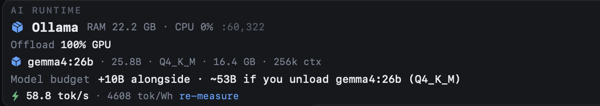

*隨選基準測試：「Measure tok/s」會執行一次簡短的生成，量出模型的解碼速度與能源效率（**tokens/sec · tokens/Wh**），並依模型分別儲存。*

> 📊 **在自己的 Mac 上量過 tok/s 嗎？** 歡迎[貼到 Discussions](https://github.com/kennss/SiliconScope/discussions/5)。大家一起整理的各晶片對照表，能幫其他人挑到合適的硬體。

## 4.0 新功能

### 🛰 Fleet：在同一個儀表板裡看其他機器

在遠端主機上執行 agent 之後，它就會出現在 **This Mac** 旁邊的 **Devices** 側邊欄。同一個區域網路裡的機器會透過 mDNS 自動找到，不必設定 IP。

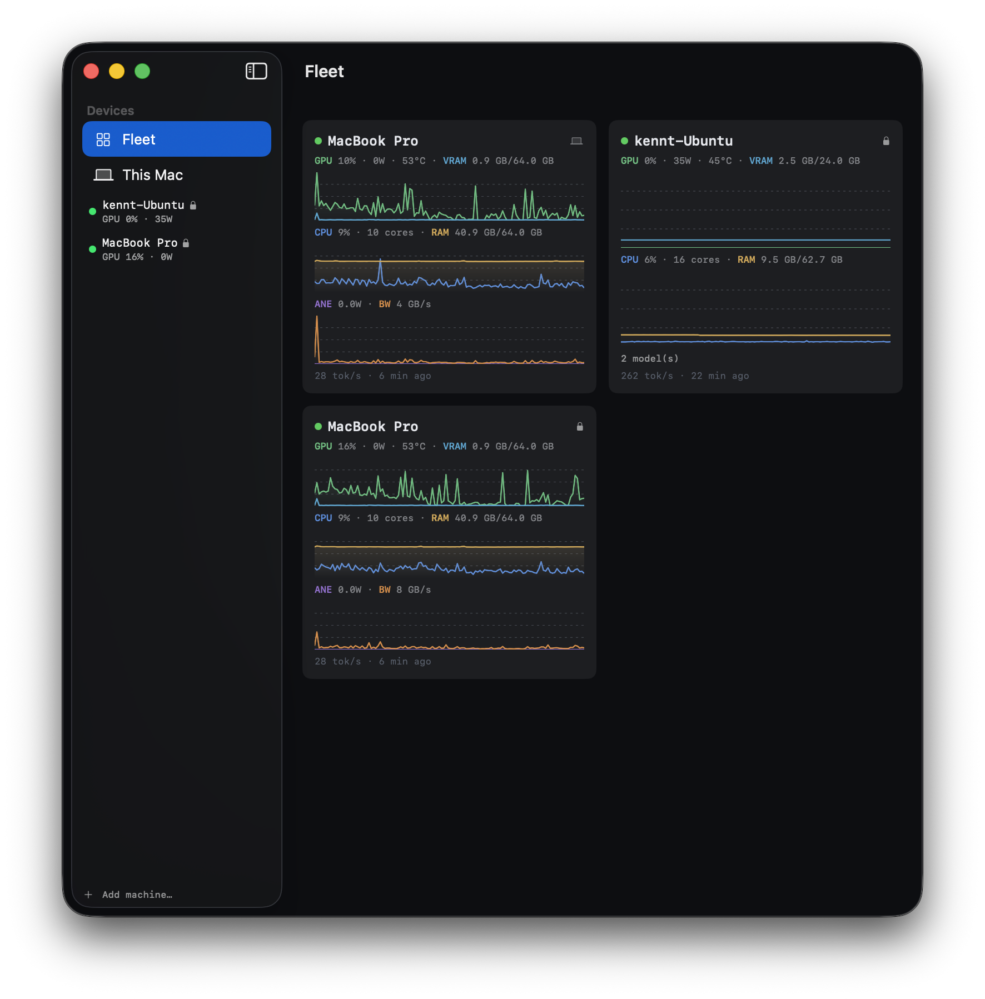

*四台機器一覽無遺：這台 Mac、一台跑在 **97 %**、**335 W** 的 RTX 3090 主機、一台 Synology NAS 和一台雲端 Droplet。每張圖磚都把 **GPU + VRAM** 和 **CPU + RAM** 畫在同一個座標軸上，Apple Silicon 機器另外加上 **ANE + 記憶體頻寬**。指標名稱的顏色和它的曲線相同，所以不需要圖例。圖磚最下面是這台機器在跑什麼：GPU 主機有 **2 個模型**和 **3 個容器，其中 1 個重啟過**（橘色），Droplet 有 **8 個容器**。這台 Mac 永遠是第一張圖磚。*

- **遠端 Mac 使用和本機完全相同的儀表板**：E/P 核心、GPU、**ANE**、Media、記憶體頻寬、功耗、風扇。就我所知，目前沒有其他工具能顯示**遠端 Mac 的 Neural Engine**。
- **Linux/NVIDIA 主機則以 GPU 為主**：使用率、VRAM、功耗與顯示卡上限的對照、溫度，也回答對 Apple Silicon 提出的同樣問題：是不是**卡在頻寬上**，時脈離上限多遠，**是什麼壓住時脈**（功耗上限、過熱降頻）。再往下是它在跑什麼：哪些程序佔用 VRAM（以腳本名稱和容器名稱顯示）、**Ollama** 模型、**ComfyUI** 佇列，以及附上重啟次數的**容器**。它不會硬把 3090 當成有 E 核心。
- **沒有 GPU 的伺服器**（例如用 Docker 跑服務的雲端 Droplet）會顯示容器、CPU、記憶體和磁碟，而且不必給 agent root 權限就能讀取。

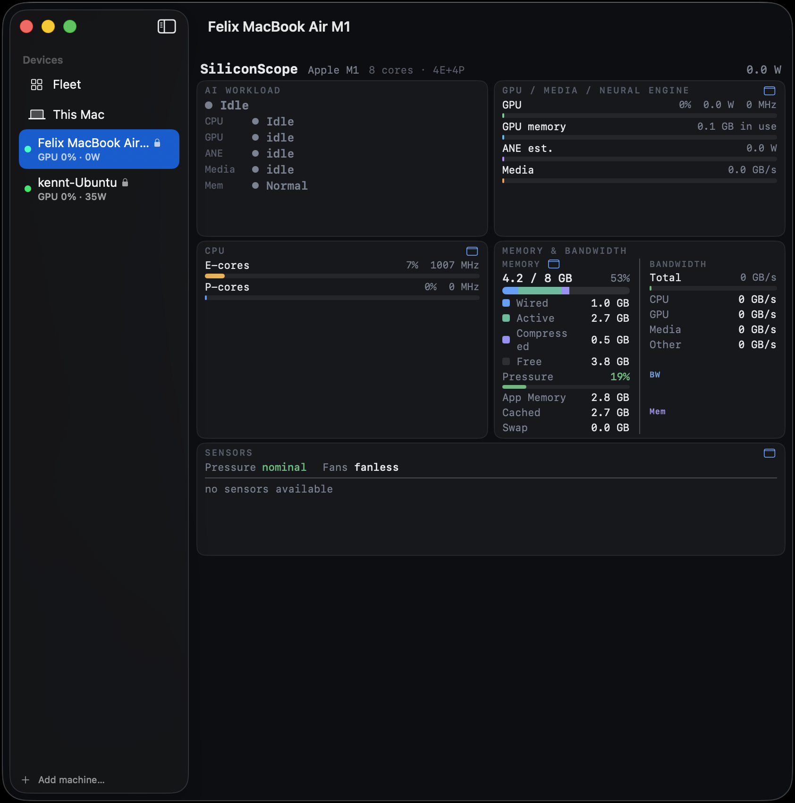

*從另一台 Mac 看一台不接螢幕的 M1 Air：**4E+4P** 核心、GPU/Media/**ANE 估計值**，以及實際的記憶體組成（**wired 1.0 / active 2.7 / compressed 0.5 GB**，壓力 19%）。感測器也如實回報 **fanless**，不會憑空編出風扇轉速。透過連線協定取不到資料的卡片會直接省略，不會造假。*

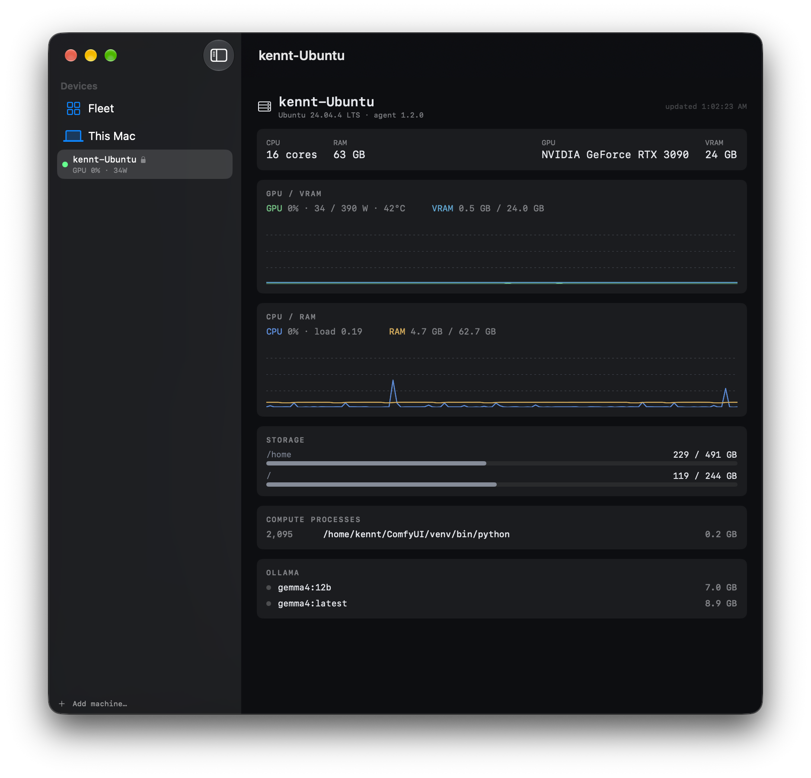

*同一個 App，換一種機器。一張 RTX 3090 跑在 **305 / 390 W**，也看得到它為什麼這樣跑：記憶體頻寬 **43 % 忙碌**，核心時脈 **2130 MHz 中的 1920 MHz**（P2），沒有任何因素壓住時脈。佔用 VRAM 的程序以腳本名稱顯示：`whisper-bench` **5.2 GB**，ComfyUI **0.2 GB**。旁邊是 ComfyUI 佇列、磁碟上的 Ollama 模型和容器，其中一個顯示「Up 3 minutes」的容器其實已經**重啟了 485 次**。沒有 E 核心，也沒有 ANE，因為這台機器本來就沒有。*


*一台透過 Tailscale 連線的 2 vCPU 雲端 Droplet。沒有 GPU，所以畫面從它在跑什麼開始：8 個容器，經由唯讀 Docker 代理讀取，agent 從不持有 root 權限。下面是 CPU、記憶體和磁碟。設定方法見 [Fleet 使用手冊](docs/fleet.md#a-cloud-server-vps)（英文）。*

每一條連線都經過 **TLS 加密與權杖（token）驗證**。檢視端第一次連線時會釘選 agent 的憑證（TOFU），之後如果 agent 換了金鑰或遭人冒充，檢視端會直接拒絕連線，不會默默信任。

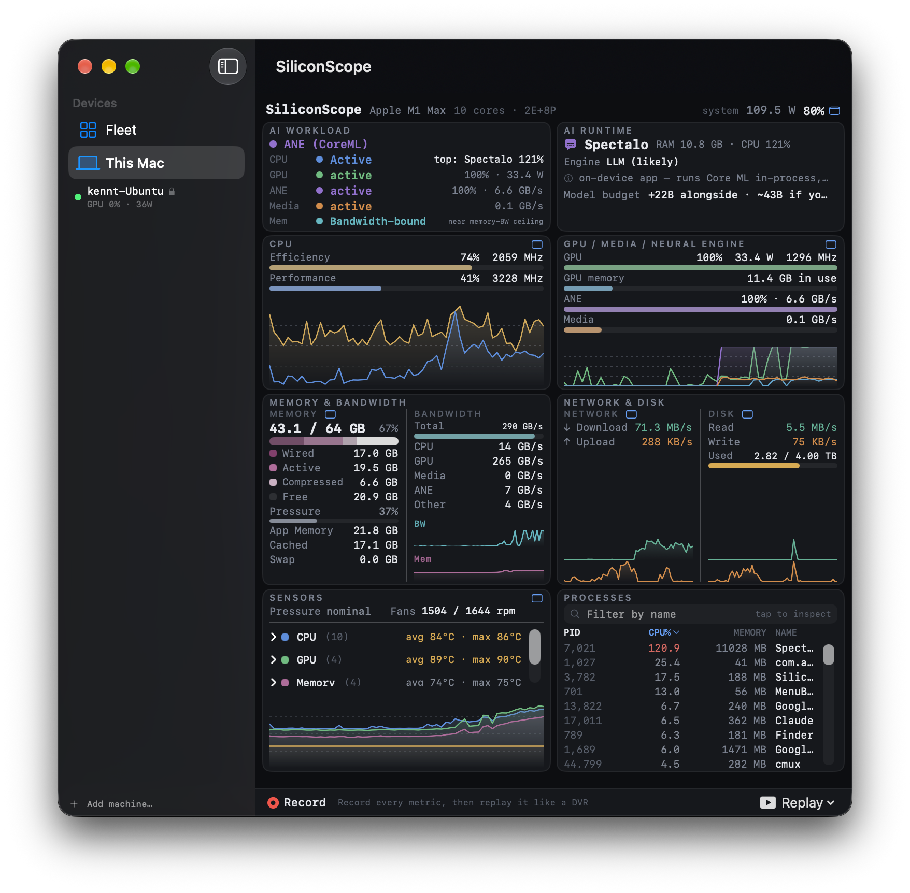

*只用一台 Mac 的話，一切照舊：還是同一個儀表板，只是多了一個可以收合的 **Devices** 側邊欄。收起來就和 3.x 完全一樣。*

#### 安裝 agent

Linux 和 macOS 都是同一行指令：

```sh
curl -fsSL https://raw.githubusercontent.com/kennss/SiliconScope/main/scripts/install-agent.sh | sh
```

安裝結束時會印出一條 `sscope://pair…` 連結，貼到應用程式的 **Add machine…** 裡，新增和配對一步完成。如果是你正在用的 Mac，不需要裝 agent，打開 **Settings → Share this Mac to Fleet** 即可。

**📖 [Fleet 使用手冊](docs/fleet.md)**（英文）——不接螢幕的 Mac、Linux GPU 主機、不給 agent root 權限、透過 Tailscale 連線的雲端伺服器、Intel Mac、Windows、更換 token、移除 agent，以及連不上時該檢查什麼。

## 3.0 新功能

### 🧠 程序檢查器：免 sudo 查看各程序指標

點一下任何程序就能開啟檢查器。它會顯示活動監視器看不到的資訊：**CPU（P/E 拆分）· IPC · 各程序功耗（W）· 記憶體 · 磁碟**，每一項都附即時迷你走勢圖；另外還有一項其他工具都不會逐程序顯示的訊號：**Neural Engine 記憶體**。哪個 App 正在用 ANE、佔了多少，一眼就看得出來。

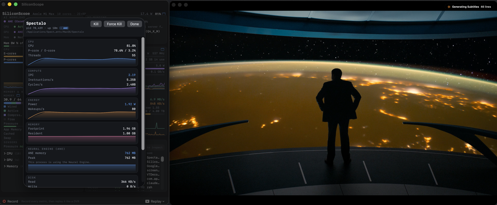

*一款裝置端語音轉錄 App 正在即時執行（右側）：65% CPU、**2.43 IPC**、**0.64 W**，以及 **762 MB 的 Neural Engine 記憶體**，這是其他監控工具從來不會逐程序顯示的 ANE 佔用量。macOS 只提供全系統數據的加速器（GPU / ANE 功耗 / Media / 頻寬）都會清楚標示，絕不捏造各程序的數字。*

### ⏺ 錄製與回放：Mac 指標的 DVR

按下 **Record**，SiliconScope 就會把所有指標（CPU、GPU、ANE、Media、頻寬、功耗、感測器、程序）持續寫進一個精簡的 `.ssrec` 檔案。之後可以用**播放 / 暫停 / 拖曳 / 倍速**重播整個儀表板，抓到那種等你轉頭去看時早就消失的尖峰。所有資料都留在你的 Mac 上；也可以匯出錄製檔分享給別人，或日後拿來比對不同次的執行結果。

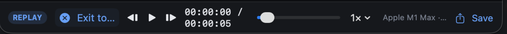

*Replay 控制列：播放 / 暫停 / 單步、拖曳時間軸、調整倍速，以及儲存錄製檔（Save）。*

## 開發緣由

SiliconScope 是我在開發裝置端 AI 影片播放器 **[Spectalo](https://spectalo.calidalab.ai/zh/)** 時做出來的。為了看清楚它到底怎麼使用晶片，我常常同時開著兩個監控工具，但兩個都不合用：

- **asitop / NeoAsitop** 有晶片層級的數據，但 TUI 介面看起來粗糙，細節也少。
- **btop** 漂亮又資訊密集，偏偏看不到我最需要的東西：**ANE（Neural Engine）、Media Engine 與記憶體頻寬。**

兩個並排開著很彆扭，也浪費螢幕空間。我原本打算 fork NeoAsitop 和 btop 把缺的部分補上，後來決定乾脆好好做一個：**一個原生、好看的 GUI**，把 Apple Silicon 特有的訊號呈現出來，而且不只終端機老手，一般人也真的看得懂。

所以我就把它做出來了。

做出來之後，我發現終於可以跟用了好幾年的日常監控工具 **iStat Menus** 說再見了。**2.0** 就是這樣的版本：SiliconScope 在這一版補齊了完整的選單列工具、各單元感測器與電池健康度，足以在我自己的 Mac 上取代 iStat。

## 安裝

**Homebrew** 是最簡單的方式：

```sh
brew install --cask siliconscope
```

或者下載 DMG：**[⬇ 下載最新 DMG](https://github.com/kennss/SiliconScope/releases/latest)**，然後：

1. 開啟下載好的 `SiliconScope-*.dmg`
2. 把 **SiliconScope** 拖到**應用程式**資料夾
3. 啟動 App

App 已使用 Developer ID 簽署並通過 **Apple 公證**，開啟時不會跳出 Gatekeeper 警告。需要 **macOS 14+ · Apple Silicon**。之後會透過 Sparkle **自動更新**，這會是你最後一次手動下載 DMG。

> **不支援 macOS 預覽版（Beta）。** 本專案只有一台 Mac，而且跑的是正式版，所以沒辦法在這裡重現或驗證開發者 Beta 上的問題。
> 不過仍然歡迎回報，過去也確實幫上了忙：SiliconScope 讀取的私有 IOReport 介面，Apple 會在不同版本之間改名，越早發現改名，就能在影響所有人之前修好。只是修正會配合正式版推出，不會針對個別 Beta 版本發布。

想自己建置？請參考英文 README 的 [Build & run](README.md#build--run)。

量測部分是名為 `SiliconScopeCore` 的 Swift 函式庫，可以整合進你自己的工具。請參考[當作函式庫使用](docs/library.md)（英文）。它不是穩定的 API。

## 功能亮點

- **程序檢查器** *(3.0 新增)*：鎖定單一程序，查看 CPU（P/E 拆分）、IPC、各程序**功耗（W）**、記憶體、磁碟與 **Neural Engine 記憶體**，全部免 sudo
- **錄製與回放** *(3.0 新增)*：把所有指標錄進 `.ssrec` 檔案，再以**播放 / 暫停 / 拖曳 / 倍速**重播儀表板，就像 DVR
- **AI Workload 檢視**：瓶頸分類器（*bandwidth-bound* / *compute-bound* / *thermal-throttled* / *memory-pressured*），以各晶片的記憶體頻寬規格上限為基準判斷，回答「現在是什麼在拖慢我的本機 LLM？」
- **E 核 / P 核分開顯示**：各叢集使用率 + 實際 DVFS 頻率
- **GPU**：使用率、功耗、頻率
- **ANE 與 Media Engine**：Neural Engine 活躍度（實測叢集駐留率）、功耗與記憶體流量，以及媒體編解碼頻寬（和其他工具最大的不同）
- **記憶體頻寬**：CPU / GPU / Media / ANE / 合計 GB/s（判斷本機 LLM 瓶頸的關鍵訊號）
- **記憶體**：Wired / Active / Compressed / Free 堆疊長條圖 + macOS **記憶體壓力**警示
- **網路** ↑/↓ 與**磁碟**讀寫 + 剩餘空間，附即時圖表
- **各單元溫度**：透過依世代整理的 SMC key 讀取真正的 **E-Core / P-Core / GPU / Memory** 感測器（M1–M5，其他機型改用 HID）、風扇轉速、熱壓力，以及 **GPU 降頻偵測**（負載壓力下，時脈是否一直低於近期峰值）
- **電池**：充電狀態、**健康度 %、循環次數、狀態**（AppleSmartBattery）
- **功耗**：各電源域的 CPU / GPU / ANE / DRAM / SoC，以及電池
- **程序**：排序、篩選、強制結束，也可以**點一下開啟檢查器**（卡片內可捲動）
- **各指標獨立的選單列項目**：CPU / GPU / 記憶體 / 網路 / SSD / 感測器 / 電池都能各自釘選成獨立的選單列圖示 + 下拉選單（另有整合全部指標的「SS」駕駛艙圖示）
- **自動更新**：內建 Sparkle 更新程式，可從選單的「Check for Updates…」檢查更新
- **不需要 `sudo`。**

## 貢獻者

**SiliconScope 能正確讀取的晶片，大多是這個專案從沒跑過的晶片。** 手上只有一台 M1 Max。M2 Max、M4 Max、M5 Max 和 Intel 的支援，靠的是有人在自己的機器上量得夠仔細，不必用猜的。也有人直接寫了 App 的一部分——名字、AI 工作負載分類器、Windows agent——還有人找出了看起來沒問題、其實是錯的數字。

**👥 [每個人做了什麼](CONTRIBUTORS.md)**（英文）

## 相關專案

**[Spectalo](https://spectalo.calidalab.ai/zh/)**：同樣出自 Calida Lab 的影片播放器，介面精美，AI 字幕與翻譯全在裝置端完成（Whisper + Apple Intelligence）。SiliconScope 就是在開發它的過程中誕生的。目前在 TestFlight 免費公開測試，理念也一樣：資料絕不離開你的裝置。

<a href="https://spectalo.calidalab.ai/zh/"></a>

---

👉 建置步驟、免 sudo 的實作原理（IOReport / SMC / HID）與工程細節解析，請見**[英文 README](README.md)**。


### Calida Lab 的其他產品

重視隱私、在裝置端執行的軟體（大多針對 Apple Silicon）：

- **[SpectaLing](https://spectaling.calidalab.ai/)**：裝置端語音轉錄，加上即時翻譯與口譯（Mac/iPad）。重視隱私的 MacWhisper 替代方案。
- **[SpectArk](https://spectark.calidalab.ai/)**：即時備份你在乎的 Mac 資料夾並保留每個版本，任何變更都會在幾秒內存下，提供類似 Time Machine 的還原點，可以備份到任何磁碟或 NAS。
- **[SpectaBooks](https://spectabooks.calidalab.ai/zh/)**：一個 App 讀遍你手邊已有的書。自己的資料夾、iCloud Drive 或 Google Drive 裡的文字檔、EPUB、PDF 與漫畫都能讀，閱讀進度在 iPhone、iPad 與 Mac 之間同步，朗讀與翻譯也都在裝置端完成。
- **[SnowChat](https://snowchat.calidalab.ai/)**：以自行開發的 Signal 協定函式庫打造的端對端加密通訊軟體。
- **[SnowClaw](https://snowclaw.calidalab.ai/)**：兼顧隱私的代理式 AI（agentic AI）參考架構（工作論文）。

## 授權

MIT © 2026 Kennt Kim —— 詳見 [LICENSE](LICENSE)。

**SiliconScope** 名稱與應用程式圖示不在 MIT 授權範圍內。散布修改版本時，請使用不同的名稱與圖示。

**→ [www.calidalab.ai](https://www.calidalab.ai/zh/)** · [@kennss](https://github.com/kennss)


歡迎協助改進翻譯，直接送 PR 即可。
